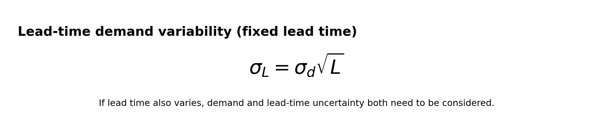

# Inventory Optimization in the Automotive Aftermarket

A practical walkthrough of inventory planning for spare parts: start with basic replenishment calculations, then choose a forecasting method that fits the demand pattern, diagnose model issues, and validate decisions through backtesting.

The examples use a **transmission assembly** as the running case. The numbers are illustrative, not a recommendation to apply one reorder point to every part. Inventory policies should be calculated at the part-location level using actual demand and lead-time data.

## 1. The problem: keep parts available without overstocking

In the automotive aftermarket, demand is often uneven. A part can sit untouched for weeks and then be needed urgently to get a truck back on the road. Stockouts affect service; excess stock ties up working capital and can become obsolete.

Suppose a transmission assembly has expected annual demand of **4,000 units**. The first step is not to reach for an advanced model. It is to establish a transparent baseline and understand the assumptions behind it.

## 2. Build a basic replenishment baseline

Assume:

| Input | Value |
|---|---:|
| Annual demand | 4,000 units |
| Working days per year | 250 |
| Average lead time | 5 working days |
| Standard deviation of daily demand | 4 units |
| Target cycle service level | 95% |
| Service factor, *z* | 1.645 |

### Average daily demand

Average daily demand is:

`4,000 / 250 = 16 units per working day`

With a five-day lead time, average lead-time demand is:

`16 × 5 = 80 units`

### Safety stock

Using the assumptions above:

`SS = 1.645 × 4 × √5 ≈ 15 units`

### Reorder point

`ROP = 80 + 15 = 95 units`

Under these assumptions, a reorder point of approximately **95 units** is the baseline.

This is a starting point, not a universal answer. The calculation assumes constant lead time, independent daily demand, and an approximately normal demand distribution. If lead time varies, demand is intermittent, or demand has strong trends or seasonality, the simple calculation may misrepresent the risk.

## 3. The demand pattern matters more than the part number

Two parts can have the same annual demand but need different forecasting approaches.

| Month | Part A: regular demand | Part B: intermittent demand |
|---|---:|---:|
| Jan | 10 | 0 |
| Feb | 10 | 0 |
| Mar | 10 | 60 |
| Apr | 10 | 0 |
| May | 10 | 0 |
| Jun | 10 | 0 |
| Jul | 10 | 0 |
| Aug | 10 | 60 |
| Sep | 10 | 0 |
| Oct | 10 | 0 |
| Nov | 10 | 0 |
| Dec | 10 | 0 |
| **Annual total** | **120** | **120** |

Part A has a stable pattern. Part B has long stretches of zero demand followed by occasional large orders. An average of 10 units per month hides that difference.

Before choosing a model, classify demand by frequency, variability, lifecycle and business criticality. A forecast should reflect how the part is consumed, not merely which algorithm is fashionable this quarter.

## 4. Croston's method for intermittent demand

Croston's method was designed for demand with many zero periods. Instead of smoothing every period as if demand were regular, it separately smooths:

- **Demand size:** the size of each non-zero demand event.
- **Demand interval:** the number of periods between non-zero demand events.

The forecast is the smoothed demand size divided by the smoothed interval. This can be more useful than applying a standard exponential-smoothing method to a series dominated by zeros.

### SBA and TSB variants

Croston's original method can be biased. The **Syntetos–Boylan Approximation (SBA)** applies a correction:

**Teunter–Syntetos–Babai (TSB)** updates the estimated probability of demand every period, including periods with zero demand. That makes TSB useful when demand may be declining or a part may be approaching obsolescence.

Important limitation: Croston-family methods produce point forecasts, but a point forecast alone does not provide a reliable distribution of demand over lead time. Safety stock and service-level decisions need additional uncertainty estimation or empirical simulation.

## 5. ARIMA and SARIMA for time-dependent patterns

When demand has useful time-series structure, ARIMA or SARIMA may be worth testing.

- **ARIMA** models autocorrelation and differencing in a time series.
- **SARIMA** extends ARIMA to handle repeating seasonal patterns.
- **ARIMAX/SARIMAX** can include external predictors, such as fleet size or repair activity.

These methods are not automatic upgrades. Many aftermarket parts have too few non-zero observations for a complex time-series model to be stable. Seasonal models also need enough history to estimate recurring patterns. Test them against simple baselines and Croston-family methods on the same forecast windows.

## 6. Multicollinearity: when predictors tell the same story

Suppose a regression model uses:

- Number of trucks in operation
- Repair orders
- Workshop job cards

These measures may all rise and fall with the size of the active fleet. If repair orders and job cards have a correlation of **0.96**, the model may struggle to separate their individual effects.

The model may still predict demand reasonably well, but its individual regression coefficients can become unstable, with inflated standard errors and signs or magnitudes that change across samples. That makes coefficient-based explanations less trustworthy.

### Check the Variance Inflation Factor

For a simple illustration with two predictors correlated at 0.96:

`VIF = 1 / (1 - 0.96²) ≈ 12.76`

That is high enough to investigate. Common rules of thumb treat VIF above 5 as a warning and above 10 as potentially serious, but these are not universal cutoffs.

Useful responses include:
- Check whether the variables are measuring nearly the same operational activity.
- Remove or combine redundant predictors when business logic supports it.
- Compare coefficient stability and out-of-sample forecast performance.
- Keep a predictor if it adds real forecasting value, even when causal interpretation is limited.

Adding ARIMA/SARIMA errors does not magically remove multicollinearity from external regressors in ARIMAX/SARIMAX.

Do not confuse three separate issues:
- **Multicollinearity:** predictors overlap with one another.
- **Autocorrelation:** errors or observations are related over time.
- **Seasonality:** a pattern repeats at a regular interval.

They require different diagnostics.

## 7. Compare models with time-ordered backtesting

Use rolling or expanding forecast windows. Train only on data available before each cutoff, forecast the next window, compare against actual demand, and move the cutoff forward.

MAE is easy to interpret, but it is not enough by itself. For inventory decisions, compare at least:

- Forecast error and bias
- Fill rate or cycle service level
- Stockout frequency and backorders
- Average inventory and working capital
- Total relevant cost, including holding, ordering and shortage costs

An illustrative comparison might look like this:

| Measure | Model A | Model B |
|---|---:|---:|
| MAE | 12 | 8 |
| Safety stock | 25 | 18 |
| Achieved cycle service level | 93% | 95% |

These figures are hypothetical. They show why forecast accuracy and inventory outcomes should be assessed together. Model B looks better on these measures, but the result must be confirmed across multiple time windows and part segments.

Avoid using MAPE when actual demand can be zero, because percentage errors become undefined or misleading. Select metrics that suit intermittent demand and the business decision.

## 8. From forecast to inventory policy

A practical workflow is:

1. **Segment parts** by demand frequency, variability, criticality and lifecycle.
2. **Calculate a baseline** for lead-time demand, safety stock and reorder point.
3. **Select candidate forecasts**: a simple baseline, Croston/SBA/TSB for intermittent demand, and ARIMA/SARIMA where time-series structure is supported by the data.
4. **Diagnose the model** for residual patterns, predictor overlap and forecast bias.
5. **Backtest in time order** using the same forecast horizon and cutoffs for every candidate.
6. **Translate results into policy** using service targets, stockout costs, holding costs and working-capital limits.
7. **Monitor drift** and revisit policies when demand, lead times or part lifecycle changes.

A more accurate forecast is useful only if it improves the decision. A model with a slightly lower error score but poor service-level performance is still a bad inventory policy wearing a lab coat.

## 9. Takeaway

Inventory optimization is not a choice between a reorder-point formula and a sophisticated forecasting model. The baseline calculation explains the replenishment logic; demand classification determines which forecasting methods are plausible; diagnostics reveal where a model can mislead; and backtesting shows whether the resulting policy performs in practice.

For a real deployment, repeat the analysis at the part-location level, estimate lead-time uncertainty from observed data, and evaluate service and cost together. A single annual demand number is a useful starting point, but it is nowhere near the whole supply chain story.

---

*Note: All figures and part examples in this walkthrough are illustrative. Validate assumptions against actual demand history, replenishment lead times, and service requirements before using the calculations operationally.*
