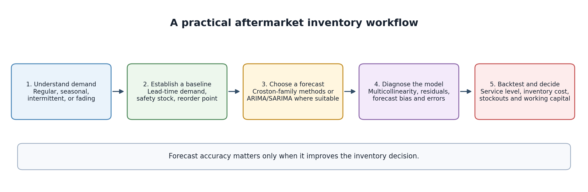
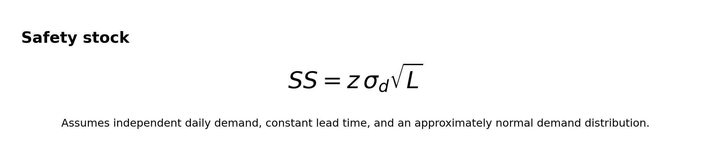
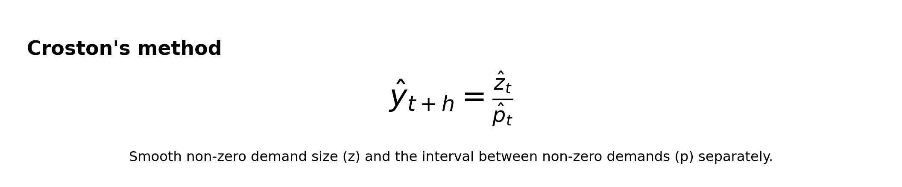
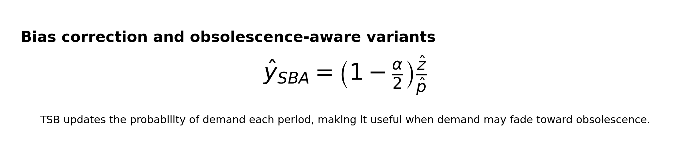
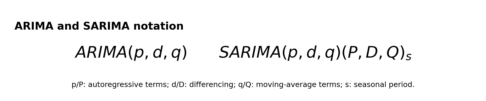
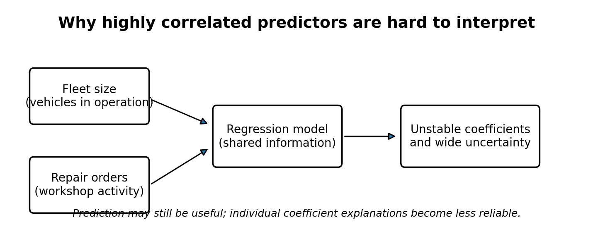
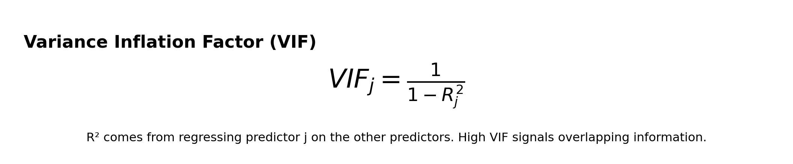
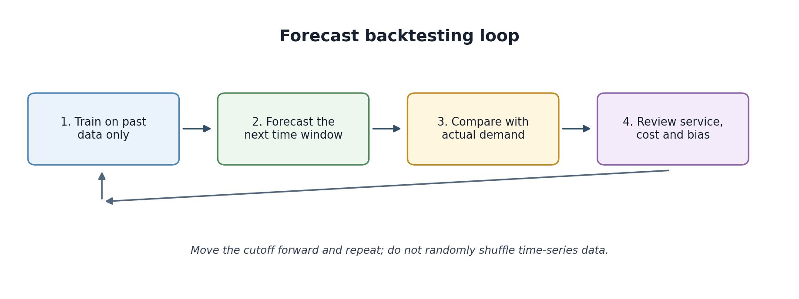

# Inventory Optimization in the Automotive Aftermarket
## From Reorder Points to Intermittent-Demand Forecasting

Spare-parts inventory planning is a balancing act. Too little stock can keep a truck off the road while a part is sourced; too much stock ties up working capital and increases the risk of parts becoming obsolete. The challenge is not simply to forecast demand accurately. It is to translate uncertain demand and replenishment into an inventory policy that meets a service target at an acceptable cost.

This walkthrough builds the logic step by step:

1. Understand the operational problem and the data behind it.
2. Calculate a transparent baseline for lead-time demand, safety stock and reorder point.
3. Recognize when average-demand calculations stop being enough.
4. Choose forecasting methods that fit regular, seasonal or intermittent demand.
5. Diagnose multicollinearity and other model issues.
6. Backtest forecasts and inventory policies using time-ordered data.
7. Translate the results into decisions about service, stock and working capital.

The example uses a fictional transmission assembly. All numbers are illustrative; they are not an operating recommendation for any real company or part.

---

## 1. Start with the decision, not the algorithm

Imagine an aftermarket distribution operation supporting a fleet of commercial trucks. A transmission assembly is expensive, takes time to replenish, and can be critical when a vehicle is down. The planner needs to decide:

- **When should a replenishment order be triggered?**
- **How much stock should be held to protect against uncertainty?**
- **How should the policy change for a fast-moving part versus a part that sells only occasionally?**
- **What service level is economically justified for this part?**

These questions are related, but they are not interchangeable.

A forecast estimates future demand. A replenishment policy uses that forecast, uncertainty, lead time, service targets and cost to determine when and how much to order. A model can improve forecast accuracy without improving the policy if it does not change the stock decision in a useful way.

### The real-world trade-off

| Too little inventory | Too much inventory |
|---|---|
| Backorders and delayed repairs | More cash tied up in stock |
| Expedites and emergency transfers | Higher holding and storage costs |
| Lower fill rate and customer service | Greater risk of ageing or obsolete parts |
| Potential downtime for the vehicle | Less capacity for other inventory |

The right answer is rarely “maximize service at any cost” or “minimize inventory at any cost.” It is usually a service-and-cost trade-off, with different targets for different parts based on criticality, demand, replenishment options and business commitments.

## 2. Understand the data before calculating anything

A reliable policy depends on more than an annual demand total. At minimum, the analysis should distinguish:

- **Demand history:** dated demand at the part and stocking-location level.
- **Lost or censored demand:** demand that may not appear as sales because the part was unavailable.
- **Replenishment lead time:** time from order placement to usable stock, including supplier processing, transport, receiving and inspection where relevant.
- **Open orders and pipeline stock:** quantities already ordered and expected to arrive.
- **Inventory position:** on-hand stock plus on-order stock minus backorders or commitments, using the organization's definition.
- **Substitutions and supersessions:** demand may shift when a part is replaced by a newer part number or an approved substitute.
- **Lifecycle and service context:** whether the part is new, mature, declining, safety-critical or being phased out.

### Why data definitions matter

Suppose a part shows zero sales for three weeks. That could mean no one needed it, or it could mean the part was out of stock and demand went unfulfilled. Those situations have different implications. Treating stockout periods as genuine zero demand can teach a forecasting model that demand is lower than it really is.

Likewise, a supplier's quoted lead time may differ from actual order-to-available-stock time. For safety-stock decisions, the observed distribution of actual lead times is often more useful than a single contractual number.

A practical first pass is to plot demand over time, plot lead-time history, identify stockout periods, and check for changes in part numbers or sourcing. Do this before fitting a model.

## 3. Build a transparent replenishment baseline

Assume the fictional transmission assembly has the following planning inputs:

| Input | Illustrative value |
|---|---:|
| Annual demand | 4,000 units |
| Working days per year | 250 |
| Average daily demand | 16 units |
| Average replenishment lead time | 5 working days |
| Standard deviation of daily demand | 4 units |
| Target cycle service level | 95% |
| Standard-normal service factor, *z* | 1.645 |

The values are chosen to demonstrate the calculation. In a live operation, estimate the demand and lead-time statistics from clean historical data, then validate the assumptions.

### 3.1 Average demand during lead time

Average daily demand is:

`4,000 / 250 = 16 units per working day`

If replenishment lead time is five working days, expected demand during lead time is:

`16 × 5 = 80 units`

This is the average demand the operation expects to consume while waiting for replenishment. It is not a buffer. If demand is higher than average during that period, or replenishment takes longer than expected, stock may run out before the order arrives.

### 3.2 Safety stock

Safety stock is the additional buffer held to absorb uncertainty. Under a common baseline assumption of independent daily demand and fixed lead time:

Where:

- `z` is the service factor associated with the selected cycle service level.
- `σd` is the standard deviation of daily demand.
- `L` is replenishment lead time in working days.

For the example:

`SS = 1.645 × 4 × √5 ≈ 15 units`

The square root of lead time appears because the variance of independent daily demand adds over time. If daily demand has variance `σd²`, then the variance over `L` independent days is `L × σd²`; taking the square root gives `σd × √L`.

This is not a universal law for every demand series. It relies on assumptions about independence and a stable demand distribution. If demand is autocorrelated, highly intermittent, trending, seasonal or affected by promotions or fleet campaigns, the formula may understate or misstate the true uncertainty.

### 3.3 Reorder point

`ROP = average lead-time demand + safety stock`

`ROP = 80 + 15 = 95 units`

In this simplified example, a replenishment trigger around 95 units is the baseline. In a continuous-review system, the inventory position is compared with the reorder point. The trigger is not necessarily based only on physical on-hand stock: open purchase orders and backorders matter too.

The reorder point answers **when to replenish**. It does not determine the order quantity. Order quantity may depend on minimum order quantities, pack sizes, supplier constraints, review frequency, economic order quantity, or a periodic-review policy.

### 3.4 Cycle service level is not the same as fill rate

A 95% **cycle service level (CSL)** means the probability of avoiding a stockout during a replenishment cycle is targeted at 95%, under the model's assumptions. It does not mean that 95% of all units demanded will necessarily be supplied immediately.

The **fill rate** measures the share of demand units fulfilled directly from available stock. A policy can have a high CSL but a lower fill rate if occasional stockouts are large. Conversely, service metrics can look different depending on whether the operation measures units, order lines, orders, or customer requests.

Always confirm which service measure the business actually uses before setting the `z` value or judging a model.

### 3.5 What changes when lead time is variable?

The previous calculation treats lead time as fixed. In reality, supplier processing, transport, customs, receiving and quality checks can all vary.

If daily demand and lead time are independent, a commonly used approximation for the variance of demand during random lead time is:

`Var(DL) = E[L] × Var(D) + E[D]² × Var(L)`

Here `E[D]` and `Var(D)` refer to per-period demand mean and variance, while `E[L]` and `Var(L)` refer to lead-time mean and variance. The square root of this variance gives an estimate of the standard deviation of lead-time demand.

This approximation has assumptions too, including independence between demand and lead time. Where enough reliable data exists, an empirical approach can be more direct: sample observed demand and lead-time combinations, calculate demand over each replenishment lead time, and estimate a buffer from the resulting distribution. The method should match the operating process and available data.

## 4. Why annual demand alone is not enough

Two parts can both have annual demand of 120 units while requiring very different planning approaches.

| Month | Part A: regular demand | Part B: intermittent demand |
|---|---:|---:|
| Jan | 10 | 0 |
| Feb | 10 | 0 |
| Mar | 10 | 60 |
| Apr | 10 | 0 |
| May | 10 | 0 |
| Jun | 10 | 0 |
| Jul | 10 | 0 |
| Aug | 10 | 60 |
| Sep | 10 | 0 |
| Oct | 10 | 0 |
| Nov | 10 | 0 |
| Dec | 10 | 0 |
| **Annual total** | **120** | **120** |

Part A has a predictable monthly pattern. Part B has long stretches of zero demand followed by occasional large events. A simple average of 10 units per month conceals the timing and variability of the demand.

For intermittent demand, useful descriptors include:

- **ADI (average demand interval):** average number of periods between non-zero demand events.
- **CV² (squared coefficient of variation):** variability in non-zero demand size relative to its mean, often used with ADI for demand-pattern classification.
- **Lifecycle status:** whether demand is stable, ramping up, declining or close to obsolescence.
- **Criticality:** the operational consequence of not having the part available.

ADI and CV² are heuristics, not laws of nature. They help organize the problem and shortlist candidate methods; backtesting should determine which method is useful for the decision.

## 5. Croston's method and its variants

Croston's method is designed for intermittent demand. Instead of treating every zero-demand period as an ordinary low observation, it smooths two quantities separately:

1. **Non-zero demand size:** how much is requested when demand occurs.
2. **Demand interval:** how many periods typically pass between non-zero demand events.

The forecast is the estimated non-zero demand size divided by the estimated interval between events. In plain terms, it estimates “how much is needed when an event happens” and “how often an event happens,” then combines those estimates into an average demand rate.

### Example intuition

Suppose a part's non-zero demands are 8, 12 and 10 units, and those events occur roughly every four periods. A simple intuition for the average rate is around 10 units per event divided by four periods, or 2.5 units per period. Croston uses exponential smoothing rather than a plain average, so recent non-zero demand sizes and intervals influence the estimates according to the smoothing parameter.

### SBA: reducing bias

Croston's original estimator is known to be biased in common settings. The Syntetos–Boylan Approximation (SBA) applies a correction:

SBA is a useful benchmark when demand is intermittent and the underlying rate is reasonably stable. It does not solve every problem: it still gives a point forecast and may not react ideally when the demand process changes sharply.

### TSB: when demand may be fading

The Teunter–Syntetos–Babai (TSB) method updates the probability of demand in each period, including periods with zero demand. It separately estimates the size of non-zero demand. Because zero periods reduce the estimated occurrence probability, TSB can react more naturally when a part is moving toward obsolescence.

This matters in an aftermarket catalogue: a part can have a long historical demand record but a declining chance of being requested because the supported fleet is ageing out, a successor part has been introduced, or a vehicle population is shrinking.

### What Croston does not tell you automatically

Croston-family forecasts are generally point estimates of the average demand rate. A point forecast is not, by itself, a complete probability distribution for demand over replenishment lead time. You still need a defensible way to estimate uncertainty and determine safety stock, service level and order quantity.

Possible approaches include empirical demand simulation, bootstrapping suitable historical patterns, or evaluating inventory policies directly through simulation. The approach should preserve the part's demand pattern and avoid pretending that intermittent demand is normally distributed just because a standard formula is convenient.

## 6. ARIMA and SARIMA: useful when the time series supports them

ARIMA models capture temporal dependence through autoregressive terms, differencing and moving-average terms. SARIMA adds seasonal structure.

- **AR (autoregressive) terms:** use past observations to explain the current value.
- **Differencing (`d`):** transforms the series to help remove a trend or make it more stationary.
- **MA (moving-average) terms:** model dependence on past forecast errors.
- **Seasonal terms:** capture repeated patterns at a chosen period, such as monthly demand with a yearly seasonal cycle.

ARIMA/SARIMA can be appropriate when there is enough history and the demand series has meaningful autocorrelation or seasonal structure. For example, workshop activity or demand for a broad family of consumables may show recurring patterns. A single low-volume spare part may not contain enough non-zero observations to estimate a complex model reliably.

### What to check before choosing a seasonal model

- Is there enough history to observe multiple seasonal cycles?
- Does the pattern repeat, or is it a one-off event caused by a fleet campaign or a large customer order?
- Are zeros and outliers dominating the series?
- Does the model outperform a simple benchmark on future-like test windows?
- Are residuals still structured, indicating that the model has not captured all the time dependence?

A sophisticated model is not automatically a better model. It is a candidate that must earn its place through out-of-sample performance and useful inventory outcomes.

### Adding external predictors: ARIMAX/SARIMAX

External variables may improve forecasts when they add information that is available at the forecast date. Examples might include active fleet size, planned maintenance activity, repair orders, installed base, or a known product campaign.

The timing matters. If a predictor would not be known when the forecast is issued, using its realized future value creates data leakage. For example, actual repair orders for next month cannot be used to claim that a forecast made today would have known them. A planned or separately forecast activity measure may be usable, but its uncertainty should be acknowledged.

## 7. Multicollinearity: when predictors overlap

Suppose a regression model uses these variables to forecast demand for aftermarket parts:

- Number of trucks in operation
- Repair orders
- Workshop job cards

They may all reflect the same underlying activity. As the active fleet grows, repair orders and job cards may rise too. When predictors move together strongly, the model has difficulty identifying the separate contribution of each one.

### Why it matters

Multicollinearity does not automatically make a regression forecast useless. It primarily makes individual coefficient estimates less stable and harder to interpret. Small changes in the data can lead to large changes in coefficients, wider standard errors, or counterintuitive coefficient signs even when overall predictions remain similar.

That creates a problem if the business wants to make statements such as “one additional repair order increases demand by exactly this amount, holding the other variables constant.” When the predictors contain nearly the same information, the data may not support that level of separation.

### VIF as a diagnostic

The variance inflation factor for predictor `j` is calculated by regressing that predictor on the other predictors and using the resulting `R²`:

`VIFj = 1 / (1 - Rj²)`

For a simplified case with two predictors correlated at 0.96, the VIF is:

`1 / (1 - 0.96²) ≈ 12.76`

That is a strong warning to investigate. VIF thresholds such as 5 or 10 are rules of thumb, not universal pass/fail criteria. Interpretation depends on the model, sample size, purpose and stability of the coefficients.

### What should a planner or analyst do?

1. Inspect correlation matrices and VIF values, but do not stop at one threshold.
2. Check whether the variables are genuinely distinct business drivers or overlapping measures of the same process.
3. Consider removing, combining or redefining redundant variables when business logic supports the choice.
4. Compare coefficient stability across time windows and model specifications.
5. Evaluate forecast accuracy and inventory outcomes on held-out periods.

Do not remove a useful predictor solely because its correlation is high. If the goal is prediction, correlated predictors may still add useful signal. If the goal is interpreting individual effects, the problem is more serious and may require a different design or stronger assumptions.

Adding ARIMA/SARIMA errors in an ARIMAX/SARIMAX model does not automatically remove multicollinearity among the external predictors.

### Keep three different issues separate

- **Multicollinearity:** predictors overlap with one another.
- **Autocorrelation:** observations or model errors are related over time.
- **Seasonality:** a pattern repeats at a regular interval.

They can coexist, but they are not synonyms and need different diagnostics.

## 8. Backtest the forecast and the inventory policy

A forecast should be evaluated as if it had been made in the past, without using information that became available later. This is the purpose of time-ordered backtesting.

A practical rolling-origin procedure is:

1. Choose a historical cutoff date.
2. Train or fit the model using only data available by that date.
3. Forecast the next period or replenishment horizon.
4. Compare the forecast with the demand that actually occurred.
5. Move the cutoff forward and repeat.
6. Aggregate performance across the test windows and relevant part segments.

Randomly shuffling a time series into train and test sets is usually inappropriate because it can allow future patterns to leak into training and does not mimic how forecasts are used operationally.

### Forecast error metrics

**MAE** is the average absolute difference between actual demand and forecast demand. It is easy to explain in units, but it does not indicate whether the model systematically under-forecasts or over-forecasts.

Also review:

- **Bias:** whether forecasts tend to be systematically high or low.
- **RMSE:** penalizes large errors more heavily than MAE.
- **Performance by segment:** high-volume parts and intermittent parts should not be hidden inside one portfolio average.
- **Error at the decision horizon:** a forecast used for a five-week replenishment lead time should be assessed over the relevant horizon, not only one day ahead.

Avoid relying on MAPE when actual demand can be zero; percentage errors become undefined or misleading. For intermittent demand, consider metrics and evaluation designs that behave sensibly with zeros, and always inspect actual forecast and inventory outcomes.

### Forecast accuracy is not the final score

Two models can have similar MAE but produce different replenishment decisions because their errors occur at different times. Under-forecasting before a long lead-time window may be more damaging than over-forecasting during a low-risk period.

A complete comparison should include:

| Forecast/model measure | Inventory/business measure |
|---|---|
| MAE or RMSE | Cycle service level |
| Forecast bias | Fill rate |
| Error by forecast horizon | Stockout and backorder frequency |
| Performance by part segment | Average inventory and working capital |
| Stability across test windows | Holding, ordering, expedite and shortage costs |

An illustrative result might look like this:

| Measure | Model A | Model B |
|---|---:|---:|
| MAE | 12 units | 8 units |
| Safety stock selected by the policy | 25 units | 18 units |
| Achieved cycle service level in simulation | 93% | 95% |

These figures are hypothetical and are not a claim that lower MAE always reduces safety stock. In a real comparison, the buffer should be derived from the model's forecast-error or lead-time-demand distribution and the target service level, then validated in simulation or historical replay.

If the business uses a periodic-review policy, the protection period is usually review period plus lead time, rather than lead time alone. That distinction can materially change the stock required.

## 9. From a forecast to an operating policy

The process becomes useful when the analysis changes a decision that planners can execute.

### Step 1: Segment the catalogue

Group parts using demand frequency, demand variability, value, criticality, lead time and lifecycle. A single method for every part is unlikely to be ideal. High-value critical assemblies may justify closer review than inexpensive common consumables; a declining part may need a different policy from a stable high-runner.

### Step 2: Establish a baseline policy

Calculate lead-time demand, safety stock and reorder point with clearly stated assumptions. This baseline is a reference point against which more advanced methods should be compared.

### Step 3: Shortlist forecasting methods

- Stable, regular demand: compare a simple average or exponential-smoothing baseline.
- Intermittent demand: test Croston, SBA and TSB.
- Strong time dependence or supported seasonality: test ARIMA/SARIMA.
- Credible external drivers: test regression or ARIMAX/SARIMAX, ensuring the predictors are available at forecast time.

### Step 4: Diagnose and backtest

Check data quality, stockout-censored demand, residual structure, predictor overlap and bias. Backtest using identical cutoffs and forecast horizons so that comparisons are fair.

### Step 5: Simulate or replay the inventory decision

Convert forecasts into orders using a consistent replenishment policy. Track service, inventory, backorders and costs. Where possible, account for order quantities, supplier minimums, review schedules, pipeline stock and actual replenishment lead times.

### Step 6: Put guardrails around deployment

A production process should flag major demand shifts, supplier lead-time changes, forecast bias, supersessions and lifecycle transitions. It should also preserve human review for high-impact parts or exceptions. Models need monitoring because the demand process can change after the model is trained.

## 10. Common traps in aftermarket inventory analytics

**Treating every zero as no demand.** Some zeros are caused by stockouts or data gaps, not lack of need.

**Using annual demand to set every policy.** Annual totals hide timing, variability, intermittent events and lifecycle shifts.

**Using a normal approximation without checking it.** The formula may be a useful baseline, but lumpy demand can violate its assumptions.

**Optimizing only MAE.** Forecast error is a proxy. The business cares about service, availability, cost and cash tied up in stock.

**Using future information in backtests.** A model must only use information that would have been available at the time the forecast was issued.

**Assuming high correlation always means a predictor must be dropped.** The right response depends on whether the objective is stable interpretation, prediction, or both.

**Treating a forecast as an inventory policy.** A forecast needs to be combined with lead time, uncertainty, service targets, order constraints and cost.

## 11. A practical implementation checklist

Before calling an inventory model ready for operational use, confirm:

- [ ] Demand is aggregated at the appropriate part-location and time grain.
- [ ] Stockout periods, substitutions and supersessions have been reviewed.
- [ ] Actual replenishment lead-time data is available and reasonably clean.
- [ ] Demand pattern and lifecycle have been considered.
- [ ] Baseline formulas and assumptions are documented.
- [ ] Candidate models are compared on the same time-ordered test windows.
- [ ] Future information is excluded from training and predictors.
- [ ] Multicollinearity and residual diagnostics are reviewed where relevant.
- [ ] Service, stockouts, inventory and cost are measured alongside forecast error.
- [ ] The policy has monitoring rules and a process for planner exceptions.

## Conclusion

Automotive aftermarket inventory optimization is not a choice between a simple reorder-point formula and an advanced forecasting model. The baseline explains the replenishment logic. Demand classification helps identify suitable forecasting methods. Diagnostics show where a model's estimates may be unreliable. Backtesting and inventory simulation establish whether the policy performs under realistic conditions.

For a real deployment, work at the part-location level, use actual lead-time and demand history, account for stockout-censored demand where possible, and evaluate service and cost together. A single annual demand number is a useful starting point, but it cannot describe the operational risk on its own.

---

*All numerical examples are illustrative. Validate assumptions and policy outcomes against actual demand, replenishment lead times, service requirements and inventory constraints before using them operationally.*
